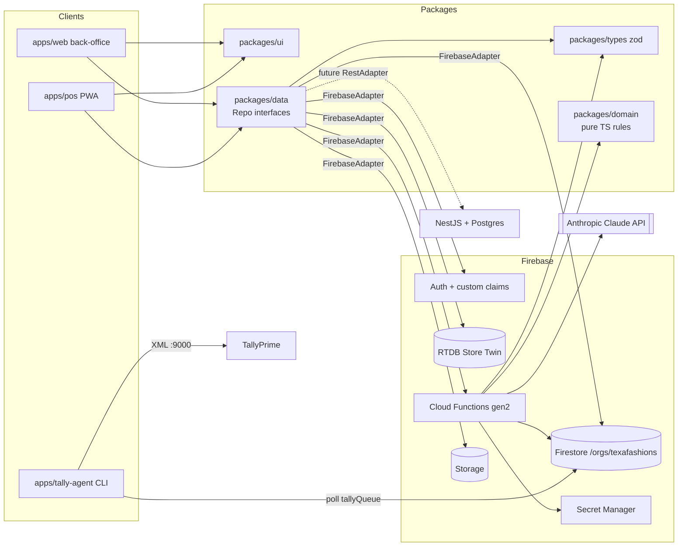
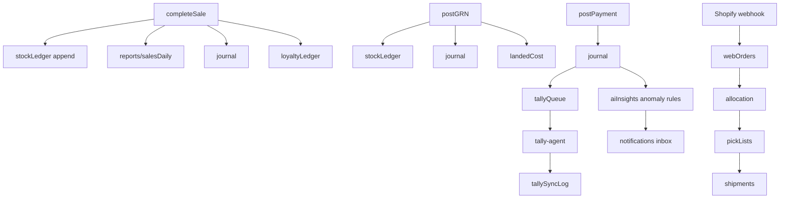

# Architecture — Texa Fashions OS (Firebase demo)

## 1. Layers


## 2. Data flow rules
- **Read:** UI → TanStack Query → `XxxRepo.get/list/subscribe` → FirebaseAdapter → Firestore snapshot.
- **Draft write:** UI → `repo.saveDraft` → Firestore (rules allow only draft statuses).
- **Command:** UI → `repo.command()` → callable function → zod validate → permission check (claims) → Firestore transaction (ledger append + summary + number series + audit) → triggers update read models, journals, notifications, tallyQueue.
- **AI:** Browser → HTTP streaming function → Claude with typed tools → tools call same domain/repo code with caller's claims → write tools return a *confirmation card*; approval triggers the real callable.

## 3. Event-driven postings


## 4. Module map
| # | Module | Web route | Key collections | Key callables |
|---|---|---|---|---|
|1|Master Data|/master|all masters, approvals|submitMasterChange, approveChange, detectDuplicates, importMasters|
|2|SCM|/scm|PR, RFQ, PO, GRN, QC, invoices|approvePO, postGRN, postQC, matchInvoice, postPayment, ocrInvoice|
|3|Inventory|/inventory|stock, stockLedger, counts|postAdjustment, freezeStockTake, runReplenishment|
|4|POS|apps/pos|sales, shifts, posOutbox, parkedBills, zReports|completeSale, processReturn, voidSale, openShift, closeShift, posPinLogin, finaliseOutbox (trigger)|
|5|OMS|/oms|webOrders, shipments|allocateOrder, packOrder, shopifyWebhook|
|6|Sales & CRM|/sales, /crm|customers, loyalty, b2b|b2bConvert, runCampaign|
|7|Promotions|/promotions|promotions, vouchers, giftCards|issueVouchers, redeemGiftCard, simulateMargin|
|8|Finance|/finance, /recon|journals, ar/ap, tallyQueue|postJournalFromEvent, fileGstReturn, runRecon|
|9|HR|/hr|employees, payrollRuns|runPayroll, approveLeave, fnf|
|10|AI|orb, /insights, /projections|aiInsights, aiChats|unichat (stream), nightlyInsights, projectStore|
|11|Store Twin|/twin|RTDB /twin|simulateTwinTick (scheduled)|
|12|Admin|/admin|auditLogs, settings|setClaims, resetDemo, simulateBusyHour|

## 5. Firestore collection tree (under `/orgs/texafashions`)
```
/orgs/texafashions
├─ MASTER: companies gstins stores warehouses bins departments categories subCategories brands
│          collections styles skus blindboxSeries priceLists vendors vendorPriceLists customers
│          customerTiers transporters chas ledgers costCentres taxCodes paymentModes bankAccounts
│          fxRates promotionTypes voucherSeries giftCardSeries loyaltyRules employees hrDepartments
│          designations shifts holidays leaveTypes salaryStructures statutorySettings reasonCodes
│          approvalMatrix numberSeries roles notificationTemplates
├─ SCM: replenishmentSuggestions purchaseRequisitions rfqs quotations purchaseOrders/{id}/versions
│       poAcks asns billsOfEntry gateEntries grns qcInspections putawayTasks purchaseInvoices
│       matchResults paymentVouchers debitNotes purchaseReturns landedCosts stockTransfers ewayBills
├─ INVENTORY: stock/{locationId_skuId} stockLedger(append-only) cycleCounts stockTakes adjustments
├─ SALES/POS: shifts tills sales/{id}/lines returns parkedBills reservations zReports posOutbox
├─ OMS (P4): webOrders(units[], timeline[]) pickLists shipments rtoCases codRemittances · connector: shopifyEvents(idempotency ledger) failedEvents(retry queue) stockPushRuns shopifyStock syncHealth
├─ CRM: loyaltyLedger campaigns segments reviews b2bQuotations salesOrders deliveryChallans
├─ PROMOTIONS: promotions vouchers giftCards/{id}/txns creditNotes referrals
├─ FINANCE: journals(append-only, lines balance) arInvoices apBills receipts payments pettyCash
│           expenses fixedAssets depreciationRuns budgets gstReturns tallyQueue tallySyncLog periodLocks
├─ RECON: reconRuns reconItems reconMatches
├─ HR: candidates jobOpenings onboarding attendance rosters leaveRequests kpiReviews commissions
│      payrollRuns/{id}/payslips exits
├─ AI: aiInsights notifications(users/{uid}/inbox) aiChats/{id}/messages forecasts storeProjections
├─ REPORTS (read models): salesDaily/{store_date} salesHourly footfallHourly stockAgeing ...
└─ SYSTEM: counters approvals auditLogs settings
RTDB: /twin/{storeId}/{floorId}/people/{trackId} {x,y,zone,activity,role,updatedAt}, /twin/{storeId}/stats
```

## 6. Security model
- Custom claims `{role, storeIds[], approvalLimitPaise}` set by `setClaims` (Super Admin only).
- Firestore rules: read scoped by role + storeIds; draft-only client writes; deny on ledgers/stock/invoices/payments/auditLogs; vendor role limited to own PO/ASN docs. Storage rules mirror.
- App Check on callable + HTTP functions (debug token in emulator).
- Rules unit-tested per role with @firebase/rules-unit-testing.

## 7. Packages
- `types`: zod schemas for every collection + callable I/O. Source of truth for future DTOs.
- `domain`: promotion engine, GST, landed cost, 3-way match, valuation (WAC/FIFO), payroll (PF/ESI/PT/TDS/LWF), Tally XML builder, forecasting, number series format. No I/O.
- `data`: `ProductRepo StockRepo PurchaseRepo SalesRepo FinanceRepo HrRepo PromoRepo AiRepo …`, `firebase/` adapter, `rest/` placeholder.
- `ui`: Texa Soft components, motion primitives, mascots.

## 8. Demo runtime
`pnpm demo` → `firebase emulators:start` (auth, firestore, functions, storage, database, pubsub) → seed script → `apps/web` :3100 + `apps/pos` :3101. Claude calls require `ANTHROPIC_API_KEY` in functions `.secret.local`; without it, AI functions fall back to deterministic canned responses so the demo still runs.

## 6. POS / promotions addendum (Phase 3)
- `apps/pos` talks only to `PosRepo` (`packages/data`): snapshot reads served from Firestore's IndexedDB cache (`persistentLocalCache`) so catalogue, stock, promotions and customers keep working offline; one `command()` per callable.
- **Direct client writes (drafts only):** `posOutbox/{clientSaleId}` (create-only, store-scoped) and `parkedBills`. Everything that moves stock/money/status is a callable or the `finaliseOutbox` trigger, both running `completeSaleCore` in one Firestore transaction.
- **Queries must carry `storeId`:** store-scoped rules cannot prove access from a `shiftId`/`tillId`-only filter, so every POS list query also filters `storeId ==` (see `subscribeSales/Returns/Outbox`).
- New operational collections: `tills, shifts, sales (lines[] embedded), returns, zReports, posOutbox, parkedBills, reservations, promotions, vouchers, giftCards/{id}/txns, creditNotes, loyaltyLedger, journals, salesDailyShards (sharded counter), posUsers (server-only)`.
- Journals posted by `completeSaleCore`/returns: Dr tender ledgers (+ gift card / credit note / loyalty liabilities), Cr `L-SALES` + output GST, round-off to `L-ROUNDOFF`, Dr `L-COGS` / Cr `L-INV`. Phase 5 reads `journals` into `tallyQueue`.

## 7. OMS / Shopify addendum (Phase 4)
- **Inbound:** `shopifyWebhook` (HTTPS, 2nd gen, asia-south1) verifies HMAC on the raw body with the Secret Manager secret, dedupes on the event id, maps the payload (`mapShopifyOrder`) and creates the order, allocation, reservation and pick lists in one transaction. A verified-but-failed event is acknowledged (200) and parked in `failedEvents`; Shopify's own retries are never relied on.
- **Outbound:** `scheduledStockPush` computes web-sellable quantity per SKU (buffers in `STOCK_PUSH_POLICY`) and pushes only changes through the `ShopifyAdmin` adapter (mock store here).
- **Courier:** `CourierAdapter` (mock Shiprocket) books at `createShipment`; tracking arrives on `courierWebhook` (token header) or the demo buttons, both calling `applyCourierEvent`.
- **Ledger effects:** reservation (`reserved` bucket) at allocation; at dispatch/handover `reserved` and `onHand` fall, invoice `WINV/…` and a `web_sale` journal are written; RTO writes `inQC` receipts, a credit note and `web_rto_reversal`; COD remittance writes `cod_remittance` (Dr bank + fees, Cr `L-COD-CLR` + `L-SUSPENSE`).
- **Read models:** `syncHealthReport` is computed on demand (no rollup yet); the dashboard also subscribes live to `failedEvents`, `shopifyEvents`, `stockPushRuns`.
