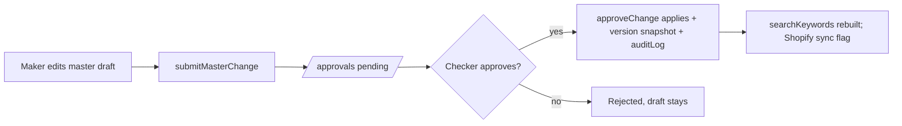

# Flow — Master Data

**Callables:** submitMasterChange, approveChange, importMasters (chunked), detectDuplicates (Claude).
**Screens:** registry-driven list/detail per master, version drawer, import wizard (upload → validate preview → commit), label print.
**Rules:** zod per master; unique keys (SKU code, barcode, GSTIN); maker != checker.

_Status: built in Phase 1._
- Approval doc for `bulk` kind holds ≤200 rows; applying it is one batch of ≤402 writes (under the 500 limit).
- Seeded data is written directly by the seed script (version 1, `updatedBy: seed`), bypassing maker-checker by design.
- The HR shift master is stored as `hrShifts` (not `shifts`) so it never collides with the POS `shifts` collection.
- Zones store polygons as `[{x,y}]` because Firestore forbids nested arrays.

## Inventory
`packages/types`: roles/claims, 43-master registry (field defs → zod + forms + CSV + keywords), approvals.
`packages/domain`: money, number series/FY, GSTIN checksum, duplicate similarity (7 tests).
`packages/data`: `AuthRepo`/`MasterRepo`/`AdminRepo` + FirebaseAdapter (+ RestAdapter placeholder).
`functions`: demoSignIn, setClaims, listUsers, submitMasterChange, importMasters, decideApproval, detectDuplicates.
Rules: Firestore/Storage/RTDB + 40 rules tests; smoke test of 19 callable flows.
`apps/web`: login role switcher, shell (sidebar, ⌘K, store switcher, bell, theme, AI orb placeholder), Master Data (list/CRUD/import/export/history/labels/duplicates), approvals queue, users, audit log, /design. `apps/pos`: placeholder page.
Seed: 43 masters, ~2,650 docs (8 stores, 301 SKUs incl. 1 planted duplicate, 20 vendors, 2,000 customers, 60 employees, ledgers mapped to Tally names), 10 demo users, 1 pending approval.
