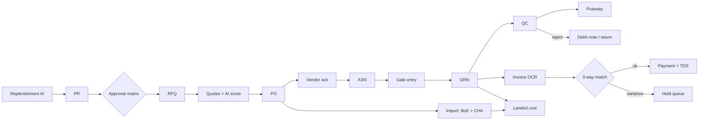

# Flow — SCM (procure-to-pay)

**Callables:** convertToPR, approveDoc, createPO, amendPO, postASN, postGRN, postQC, ocrInvoice, matchInvoice, postPayment, postLandedCost, dispatchTransfer, receiveTransfer.
**Domain:** 3-way match tolerance, landed cost apportion, TDS, MSME 45-day, GST on transfers.
**Doc-flow tracker:** each doc stores `chain[]` of linked doc refs rendering the animated stepper.

_Status: built in Phase 2._
- Approval = delegation of authority: the matrix names the signing role per amount; the maker auto-approves only if they hold that role **and** their own limit covers it, otherwise another user must approve (`decideDocument`).
- Every stock-changing command runs `StockEngine`: GRN → *in QC* (+cost, WAC); QC pass → *on hand* (putaway task, bin suggestion); QC reject → *damaged* + auto-drafted return and debit note; return dispatch issues the debit note and nets it against the next AP bill for that PO.
- 3-way match uses accepted GRN qty minus already-billed qty; price tolerance 2%, qty 0, total 1% (`settings/matching`). Failures go to the hold queue; CFO can re-match, override (note audited) or reject.
- Payment allocates oldest-due first, TDS on the taxable share; >₹2L routes to Super Admin. "Paid" completes when every AP bill on the PO is settled.
- Import: BoE (BCD, SWS 10% of BCD, IGST on AV+BCD+SWS) feeds landed cost; IGST is input credit, never cost.

## Inventory
`packages/domain`: landed cost (largest-remainder apportion), 3-way match, import duty, GST split, e-way threshold, WAC/FIFO/ageing/ABC, seasonal replenishment, approval routing, vendor score, bin suggestion, MSME due date, TDS — 31 tests.
`functions`: `engine.ts` (StockEngine + number series), `scm/{procure,receiving,payables,transfers}.ts`, `inventory.ts`, `commands.ts` (zod-validated callable factory; handlers are plain functions so the seed and tests call them directly). ~35 callables + `nightlyReplenishment`.
`packages/data`: `ScmRepo` (generic list/get/subscribe + typed `command(name, input)` driven by `COMMAND_SCHEMAS` in packages/types).
Web: `/scm` (+ replenishment, purchase [PR/RFQ/PO/ASN/BoE], receiving [gate/GRN/QC/putaway/returns], payables [invoice OCR/hold/AP/payments/landed cost], transfers), `/inventory`, `/vendor` portal, PO and RFQ detail pages with the animated document-flow tracker.
Seed: stock + dated opening ledger layers for 8 stores + warehouse (6.7k docs), then ~35 documents at every SCM stage created **through the real handlers** (`scripts/seed/src/scenarios.ts`).
Tests: `pnpm --filter @texafashions/smoke-tests scm` (44 API checks), rules tests now 85, Playwright `phase2.spec.ts`.

## Additional conventions
- Money in foreign currency is stored as minor units (major × 100); INR paise = minor × `ratePaisePerUnit` / 100.
- Operational docs carry `status`, `approverRole`, `requestedBy/createdBy`; PO is the hub and holds `flow` (PR/PO/ASN/GRN/QC/Invoice/Paid refs) for the stepper.
- Store-scoped roles must filter list queries by `locationId`/`storeId in storeIds` (`useScope().where(...)`) or Security Rules reject the query.
- Vendor files live under `vendor-portal/{vendorId}/…` in Storage (own-folder rule).
- Firestore `undefined` fields: functions set `ignoreUndefinedProperties`.
- Demo approval matrix changed in Phase 2 (PR: buyer/cfo/super_admin; PO: buyer ≤₹5L, cfo ≤₹50L; payment: cfo ≤₹2L else super_admin; adjustment: warehouse_manager ≤₹10k else cfo).
