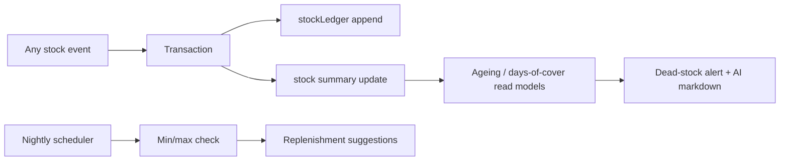

# Flow — Inventory

**Stock states:** onHand, reserved, inTransit, inQC, damaged, tester; ATP = onHand − reserved − buffer.
**Callables:** postAdjustment, startCycleCount, submitCount, freezeStockTake, reconcileStockTake.
**Domain:** WAC/FIFO valuation, ABC classification, ageing buckets.

_Status: built in Phase 2._
- Buckets: onHand, reserved (ATP = onHand − reserved), inTransit, inQC, damaged, tester; warehouse `bins` map + `unputaway`.
- Valuation: WAC kept on the stock doc; FIFO computed from dated receipt/opening ledger layers (newest layers make up what is on hand). Ageing uses the same layers.
- Full stock-take writes `stockLocks/{loc}`; the engine refuses movements at a frozen location except the reconcile.
