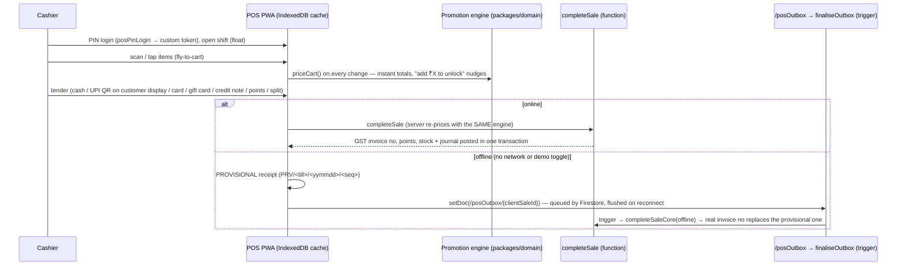

# Flow — POS (offline-first PWA, `apps/pos`, :3101)

## Routes
| Route | Purpose |
|---|---|
| `/login` | store → staff tile → PIN pad (demo PINs: cashier `1234`, manager `4321`) |
| `/shift` | pick a till, opening float, offline-readiness checklist (catalogue / promotions / customers / app shell cached) |
| `/sell` | image grid + search/barcode, cart, customer, voucher, gift wrap, park, tender dialog, success screen with confetti, receipt, WhatsApp e-bill |
| `/customer-display` | second screen: live bill, savings, UPI dynamic QR (mock auto-confirm), thank-you (BroadcastChannel link to the cashier tab) |
| `/returns` | bill QR / invoice no → pick lines + reason → cash / credit note (exchange) / original tender |
| `/parked` | parked bills + reserve-in-store |
| `/history` | this shift's bills, offline sales waiting to sync, reprint, void (manager PIN) |
| `/z-report` | live Z totals, denomination count, variance, manager sign-off, close shift |

## Rules enforced
- **Server is authoritative**: client prices are never trusted; `completeSale` loads SKU prices, promotions, vouchers, gift cards from Firestore and re-runs `priceCart`. If the tender no longer covers the server total the call fails with "price changed" and the POS re-prices.
- **Tender rule** (UI and server identical): UPI offers apply when every non-instrument payment is UPI. Gift cards, credit notes and points are *instruments* (they settle the bill, never trigger tender offers). Split bills forfeit the UPI offer.
- **Offline**: cash + card only. UPI (needs PSP confirmation), gift cards / credit notes / points (balances live on the server), vouchers, manager overrides, returns, closing a shift all need a connection. Offline sales are *priced locally*, stored in `/posOutbox`, and finalised by the `finaliseOutbox` trigger using **server pricing**; any difference from what the customer paid is recorded as `variancePaise` and flagged `needsReview`. `closeShift` is blocked while any outbox doc of the shift is still pending.
- **Stock**: POS sales may take stock negative (flagged `negativeStock`) — a counter sale is never blocked by an inaccurate stock record.
- **Manager PIN** (re-verified server-side) for: line discount overrides, voids, returns above ₹5,000 / older than 7 days / reason codes flagged `needsApproval`, shift variance above ₹100.
- **Receipts**: 80 mm thermal layout (`.receipt-print`, `@page 80mm`), GST split by rate, bill QR `INV|<saleId>` for returns. Provisional receipts are watermarked.
- **Clients write drafts only**: `posOutbox` (create-only) and `parkedBills`; everything else is a callable.

_Status: built in Phase 3 — see docs/use-cases.md §4 for what is verified vs only built._

## Inventory
`packages/domain`: `promotions.ts` (priceCart: 9 promo kinds, stacking matrix, budgets, vouchers, nudges), `instruments.ts` (gift card / credit note partial redemption, points, tiers), `invoice.ts` (GST on discounted inclusive prices, round-off, sale journal, refunds), `returnJournal.ts`, `pos.ts` (Z-report, e-bill, UPI intent, `MockPaymentGateway`, cross-sell stub) — 82 domain tests total.
`functions/src/pos/*`: `completeSaleCore` (one transaction: price → stock (allowNegative) → invoice no → journal → points → vouchers/gift cards → shards → audit), `finaliseOutbox` trigger, returns/void, shifts + Z-report, PIN login, instruments, e-bill (mock WhatsApp adapter), reserve, visualSearch. Seed: `scripts/seed/src/pos.ts`.
`packages/data`: `PosRepo` (offline-first reads, `enqueueOutbox`, `setNetwork`). `apps/pos`: /login /shift /sell /customer-display /returns /parked /history /z-report, PWA manifest + `public/sw.js`.
Tests: rules 94, `pnpm --filter @texafashions/smoke-tests pos` (61), Playwright `phase3.spec.ts` (needs `pnpm demo` + `pnpm seed` for a clean till).

## Additional gotchas
- Firestore doc ids can't contain `/`: credit notes / gift cards use `-` in ids, slashes stay in their `number`.
- Keypad/PIN listeners must be registered once (re-registering per render drops fast key presses).
- Demo PINs: cashier `1234`, manager `4321` (`CSH01`/`MGR01` per store). `test:rules` needs Java on PATH (`PATH=/opt/homebrew/opt/openjdk@21/bin:$PATH`).
- POS service worker registers only in production builds.
