# Flow — E-commerce / OMS (Phase 4)

```mermaid
flowchart LR
  SH[Shopify webhook] --> HMAC{HMAC on raw body\nSecret Manager}
  HMAC -- bad --> R401[401, nothing stored]
  HMAC -- ok --> DEDUPE{event id seen?}
  DEDUPE -- yes --> ACK[200 duplicate]
  DEDUPE -- no --> MAP[map + risk score] --> TX
  subgraph TX[one Firestore transaction]
    WO[webOrders] --> ALLOC[allocation] --> RES[reserve stock] --> PL[pick lists]
  end
  MAP -. error .-> FE[(failedEvents\nbackoff 30s..16m)] -. dead after 6 .-> HUMAN[person retries]
  PL --> PICK[pick] --> PACK[pack scan] --> SHIP[courier label + invoice + stock issue + journal] --> TRK[tracking] --> DEL[delivered]
  PL -. BOPIS .-> READY[ready for pickup 48h + code] --> COLLECT[handover: invoice + issue] 
  READY -. expires .-> REL[release stock]
  TRK --> NDR[NDR] --> RTO[RTO] --> INQC[inQC + credit note] --> QC{QC} -->|good| ONH[onHand]
  QC -->|damaged| DMG[damaged + write-off]
  DEL --> COD[COD cash with courier] --> REM[remittance import] --> RECON{reconcile by AWB}
  INV[stock] -->|onHand − reserved − buffer| PUSH[scheduled push, changed SKUs only] --> SH
```

## Order status roll-up
`new → awaiting_stock | allocated → picking → packed → partially_shipped → shipped → delivered`, `ready_for_pickup → collected | expired`, `shipped → rto`, `cancelled`. Derived (pure `deriveOrderStatus`) from the order's `units[]`.

## Allocation rules (`allocateOrder`, all-or-nothing)
1. **BOPIS**: only the pickup store, no web buffer (the shelf unit is promised to this customer).
2. **Ship**: cheapest single location covering every line. Cost = proximity (same city 0 / same state 1 / other 2) + 3 for a store, so the warehouse wins unless it cannot fulfil.
3. Else greedy split (location covering the most units first), at most 2 parcels.
4. Stores keep **2 units** back for walk-ins; reserved units are never allocatable.
5. Not coverable → `awaiting_stock`, nothing reserved; "Retry allocation" after replenishment.
6. Short pick → reservation released, shelf flagged for a count (ledger annotation, stock **not** adjusted automatically), shortage re-allocated elsewhere or flagged "needs attention".

## Stock push to Shopify
Web quantity = Σ over locations (onHand − reserved − buffer), store buffer 2, warehouse 0, **last unit hidden**, max 500. Only SKUs whose value changed since `shopifyStock/{sku}.pushedQty` are sent, in chunks of 100. Failed SKUs → `failedEvents` (kind `stock_push`) → retried by the scheduler. The Shopify side is a mock store (`ShopifyAdmin` adapter).

## Functions
HTTPS: `shopifyWebhook`, `courierWebhook`. Callable: `simulateWebOrder, allocateOrder, cancelOrder, confirmPick, packOrder, createShipment, courierEvent, markReadyForPickup, collectBopis, expireBopis, receiveRto, qcRto, importCodRemittance, simulateCodRemittance, retryFailedEvent, runRetries, pushStockNow, syncHealthReport`. Scheduled: `scheduledStockPush`, `retryFailedEvents`, `expireBopisHolds`.

_Status: built in Phase 4 — see `docs/use-cases.md` for what is verified vs only built._

## Inventory
`packages/domain/src/oms.ts` (26 Vitest tests, 108 domain total): `mapShopifyOrder` (tax-inclusive paise, COD/BOPIS detection), `riskScore` (explainable, info-only), `allocateOrder`, `webSellableQty`, `diffStockPush`, `verifyPack`, retry backoff (30s…16m, dead letter after 6), `deriveOrderStatus`, BOPIS hold/code, `validateRtoQc`, `reconcileCod`.
`functions/src/shopify/*`: `webhook.ts` (`shopifyWebhook` + `courierWebhook` HTTPS), `hmac.ts` (raw-body HMAC-SHA256, Secret Manager `SHOPIFY_WEBHOOK_SECRET` / `SHIPROCKET_WEBHOOK_TOKEN`), `ingest.ts` (event ledger `shopifyEvents`, handlers, `failedEvents` retry queue), `stockPush.ts`, `health.ts` (`syncHealthReport`), `adapter.ts` (`ShopifyAdmin` + mock store).
`functions/src/oms/*`: `orders.ts` (create + allocate + reserve in ONE transaction, re-allocate, cancel), `fulfil.ts` (pick incl. short-pick re-allocation, pack scan, shipment + invoice + stock issue + journal, courier events), `bopis.ts`, `rto.ts`, `cod.ts`, `simulate.ts`. `functions/src/adapters/courier.ts` = `CourierAdapter` + `MockShiprocket`.
Schedulers (declared; the emulator never fires them → use the buttons): `scheduledStockPush` (15 min), `retryFailedEvents` (5 min), `expireBopisHolds` (hourly).
Web `/oms` (orders + simulator), `/oms/fulfilment`, `/oms/returns` (RTO + COD), `/oms/sync` (health). Seed: `scripts/seed/src/oms.ts` (~14 orders at every stage via the real handlers, 1 poison event, initial stock push).
Tests: `pnpm --filter @texafashions/smoke-tests oms` (76), rules now 99, Playwright `phase4.spec.ts` (needs `pnpm demo` + a fresh `pnpm seed`: the COD test consumes the seeded delivered COD parcels).

## Conventions & gotchas
- **Webhook contract:** POST only → HMAC over `req.rawBody` (401, nothing stored) → dedupe on `X-Shopify-Event-Id` (fallback `X-Shopify-Webhook-Id`) in `shopifyEvents` → handle → **always 200 once verified**; failures go to `failedEvents` (payload as `payloadJson`, `retrying`→`dead`). Handlers are also idempotent on their natural key (`webOrders/SH{shopifyOrderId}`), so a replay under a new event id never double-reserves. Emulator-only fallback secrets are `DEV_SHOPIFY_SECRET` / `DEV_SHIPROCKET_TOKEN` (packages/types); outside the emulator a missing secret = 500.
- Order → `units[]` (one per pick list, kept on the order doc) → status via `deriveOrderStatus`. Every OMS mutation updates its pick list/shipment AND its unit on the order inside one transaction. Reservation = `reserved` bucket at the allocated location; dispatch/handover releases it and issues `onHand` (kind `issue`, refType `webOrderShipment|webOrderBopis`).
- Money: web prices are GST-inclusive paise; `unallocQty/unallocNet` per SKU makes pick-list nets add up exactly to the order. Invoice (`WINV/<loc>/…`) + journal are created **at dispatch/handover**, not at order time: Dr `L-GW-CLR` (prepaid) or `L-COD-CLR`, Cr `L-SALES-WEB` + GST; place of supply = delivery state (IGST if ≠ origin state); shipping is an 18% service line on the first parcel.
- RTO never returns stock straight to sellable: `receiveRto` → **inQC** + credit note (`WCN/…`) + reversing journal; `qcRto` → onHand or damaged (+ `L-SHRINK` write-off at cost). Prepaid RTO/cancel/expired-BOPIS only set `refundDue` (the refund itself is Finance, Phase 5).
- COD cash: `codStatus` awaiting_delivery → with_courier → remitted | short_paid. `importCodRemittance` (CFO) reconciles by AWB; unknown/duplicate/excess cash credits `L-SUSPENSE`; ≤200 AWBs per file; remittance id = courier+UTR (re-import refused). Ledgers added: `L-FREIGHT-OUT`, `L-SUSPENSE`; `TENDER_LEDGER` gained `COD`, `WEB`.
- Rules: `webOrders`, events, failedEvents, remittances, push history = HQ roles only (customer PII); `pickLists/shipments/rtoCases` are `locationId`-scoped (queries must filter `locationId`; use `useScope().where('locationId')`). No client writes anywhere.
- UI gotchas: `inr()` now shows two decimals whenever paise exist; shared `Dialog` has `aria-labelledby`; nav items can carry `ready: true` (OMS is live while `CURRENT_PHASE` stays 2 for the still-locked entries). In `next dev`, overlays opened within ~1 s of a client navigation can vanish (also reproducible on `/scm/transfers`; dev-server behaviour not investigated) — Playwright specs wait ~1.2 s after navigating.
