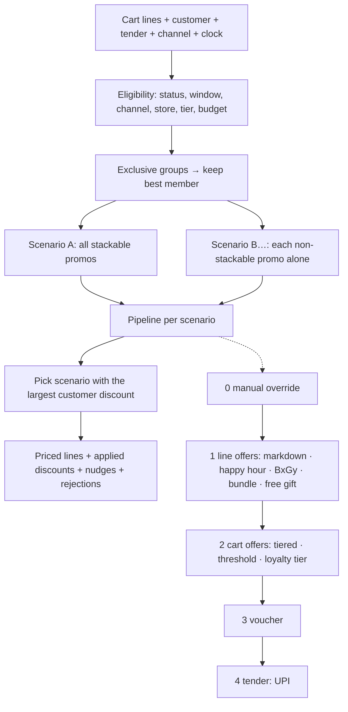

# Flow — Discounts & Vouchers engine (`packages/domain/src/promotions.ts`)

## Semantics (all covered by `promotions.test.ts`)
- Money is integer paise; prices are **GST-inclusive**. Discounts reduce the taxable value (`buildInvoice` splits tax from the *discounted* net, rounds the bill to the rupee).
- **Stackable offers compound sequentially** in `(stage, priority)` order: ₹3,000 on UPI → 5% above ₹2,000 = ₹2,850 → UPI 5% of ₹2,850 = ₹142.50 → **₹2,707.50**.
- "Above ₹2,000" is strict (`inclusive:false`): exactly ₹2,000 does not qualify. Threshold basis = eligible spend *after* line offers.
- **Buy X Get Y**: scope units sorted by price; the cheapest `floor(n/(x+y))·y` units get `discountPct` (100 = free).
- **Bundle**: components (scope + qty) → max complete bundles; the most valuable matching units are used (best deal for the customer); discount = units value − bundles × bundle price (never negative).
- **Tiered**: highest `minPaise` tier met on in-scope spend. **Loyalty tier**: % by `customer.tierId`. **Happy hour**: weekday/hour window evaluated in IST. **Free gift**: zero-priced line when spend ≥ threshold.
- **Non-stackable** promotions never combine — engine compares "all stackable" against "each non-stackable alone" and keeps the cheapest-for-customer; losers are listed in `rejected` with a reason.
- **Budget caps** clip a promotion's discount to `budgetPaise − budgetUsedPaise`; `completeSale` increments `budgetUsedPaise`.
- **Service lines** (gift wrap) and free gifts never count toward or receive offers.
- **Vouchers** (`checkVoucher`): status, validity window, channel, assigned customer, single-use, max redemptions, per-customer limit, min spend, % with cap, never above the bill; `combinable:false` makes the voucher compete with promotions. Errors surface as `voucherError`, never exceptions.
- **Gift cards / credit notes** (`instruments.ts`): partial redemption `min(balance, due)`, expiry/blocked/void checks, top-up cap ₹10,000. **Points**: 1 pt = ₹1, ≤ 50% of the bill, min 50; earn 1 pt/₹100 × tier (`earnRatePct/5`), 12-month expiry.
- **Nudges**: "Add ₹X more to unlock 5% off", "Add 1 more eligible item — Buy 2 Get 1", "5% off when you pay with UPI".

Callables: `completeSale` (redeems), `issueVouchers`, `sellGiftCard`. Same engine runs in the POS (instant totals), in `completeSale` (authoritative) and, later, on the web store and NestJS.

_Status: engine + 50 Vitest cases landed in Phase 3. Admin UI (create/approve promotions, margin simulator) is Phase 7 / Module 7 follow-up — seeded promotions are data-only._
