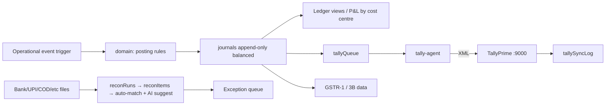

# Flow — Finance, GST, Tally, Reconciliation

**Maker-checker** on finance postings; **periodLocks** block postings in closed periods.

_Status: in progress._
- **Done:** chart of accounts, journals (append-only, drill-down), AP/AR ageing, store P&L, budget vs actual — `functions/src/finance/reports.ts`, `triggers.ts`, `apps/web/src/components/finance/screens.tsx`.
- **Done:** GST — `packages/domain/src/gst.ts` (GSTR-1 B2C/B2B/HSN, GSTR-3B, 2B mismatch), `functions/src/finance/gst.ts` (read-model callables), `apps/web/src/components/finance/gst.tsx` (tabs + CSV export). Seeded 2B feed in `gst2bRecords` (`scripts/seed/src/finance.ts`) is derived from the SCM seed's own purchase invoices, with some records mutated/omitted to exercise every mismatch status.
- **Done:** Tally sync — `packages/domain/src/tallyXml.ts` (voucher/envelope builders), `enqueueTallySync` trigger (posts every journal to `tallyQueue` with pre-rendered XML), `exportTallyXml`/`retryTallySync` callables, `apps/web/src/components/finance/tallySync.tsx` (status chips, retry, XML download), `apps/tally-agent` (polls the queue, POSTs to TallyPrime `:9000`, `--mock` to mark sent without a live Tally).
- **Done:** Mock e-invoice (IRN/QR) — `packages/domain/src/einvoice.ts`, `functions/src/adapters/gst.ts`, generated inline in `pos/sale.ts` and shown on the POS receipt (`apps/pos/src/components/Receipt.tsx`).
- **Done:** Reconciliation Centre — one generic matching engine, `packages/domain/src/recon.ts` (`match()`: exact ref+amount, amount+date window, many-to-one, in that order per rule chain), config-driven for 9 types (`RECON_TYPES`: bank, UPI, card, gateway, COD, cash, inventory vs GL, GST vs 2B, ERP vs Tally). `reconFeeds` holds both sides per type (seeded from `scripts/seed/recon/*.csv`, `side: 'source'|'target'`); `runRecon`/`decideReconMatch`/`reconAiSuggest` in `functions/src/finance/recon.ts` write `reconRuns` (one per run, match-rate summary) and `reconItems` (every matched/unmatched/AI-suggested pair). `reconAiSuggest` sends only the current unmatched rows (capped 50 a side) to Claude for pairing suggestions — never auto-applied, always accept/reject — with a deterministic closest-amount fallback when no API key is configured. UI: `apps/web/src/components/finance/recon.tsx` (type tiles with an animated match-rate gauge, run button, matched/unmatched/AI-suggested tabs).
