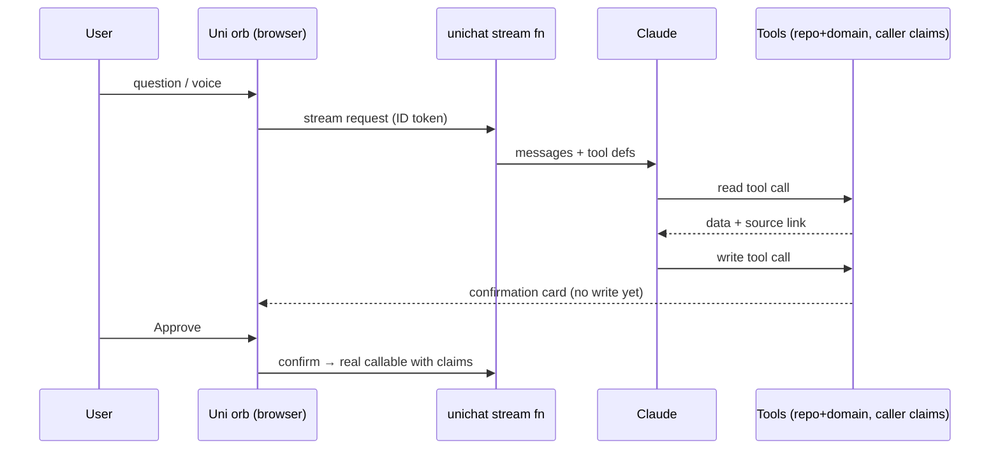

# Flow — AI layer

**Notifications:** rules + AI → aiInsights → per-user inbox fan-out.
**Fallback:** no API key → deterministic canned responses.

## Built (S6 — Uni assistant)
- `aiChat` (`functions/src/ai/chat.ts`): HTTPS streaming endpoint, `Authorization: Bearer <ID token>`, NDJSON events `text|tool|card|done|error`. Claude `claude-sonnet-5-5`, tool loop ≤5 steps, key from Secret Manager (`ANTHROPIC_API_KEY`). No key → keyword router over the same tools.
- Tools (`functions/src/ai/uni.ts`): `getSales, getStock, getLowStock, getOpenPOs, getCashVariance, getPnL` (read) and `createPurchaseRequisition, createVoucher` (propose only → `confirm` card). Every tool re-checks role + store scope from the token claims; denied → a 🔒 note card, never data.
- Confirm: client calls the real callable (`createPR` via `scm.command`, `issueVouchers` via `pos.command`), which re-checks claims again.
- Chats saved server-side to `/aiChats/{id}` (`userId`, `messages` incl. cards); rules: owner read only, no client writes.
- UI: `apps/web/src/components/UniChat.tsx`. Voice = browser Web Speech API (Chrome/Safari; button hidden elsewhere).
- Store projections: see S8 below.

## Built (S7 — notifications + insights)
- **Rules** `packages/domain/src/alerts.ts` (`evaluateAlerts(snapshot)`, thresholds in `ALERT_THRESHOLDS`): stock-out risk (<3 days cover), PO overdue, GRN variance, cash variance at close (>₹50 warn / ≥₹500 critical), void rate >3× the store's 14-day baseline (≥2 voids), voucher >5 uses per till per day, Tally sync failed, sales <40% of target after 14:00 IST. Target = average of the store's last 14 trading days (no target master yet).
- **Forecast** `forecast.ts`: seasonal moving average by weekday (last 4 same-weekdays, flat-mean fallback), `daysOfCover`, `forecastReplenishment`, `forecastMarkdown` (>8 weeks of cover). Demand history = last 28 days of `sales` lines per store × SKU; the warehouse has no sales so it gets no forecast.
- **Run** `functions/src/ai/insights.ts`: `scheduledAlerts` (every 30 min) and the `runAlertsNow` callable ("Run now" in the drawer) → `runAlerts()` gathers a snapshot, writes `/aiInsights/{ruleId_entity_day}` (create-only, so re-runs never duplicate or reopen) plus top-5 replenishment and top-5 markdown suggestions, and fans out `/inbox/{uid}_{insightId}` rows to the seeded demo accounts whose role + store scope match.
- **Inbox actions** `inboxAction` callable: read / assign (copies the row to the assignee) / snooze 4 h / resolve (resolves for everyone) / reopen; audit-logged. Rules: `inbox` readable by owner only, `aiInsights` by store scope, no client writes.
- **UI** `apps/web/src/components/notifications.tsx`: bell with real-time badge (`subscribeInbox`), drawer with Critical/Warning/Info/Done tabs, wobble toast for each critical alert arriving after first load, **Ask why** opens Uni with a seeded question (`UniChat` `seed` prop). `BriefingCard` on the home dashboard calls `dailyBriefing` — one Claude call per day per visibility scope, cached in `/aiBriefings/{day_scope}`; rule-based text without an API key.

## Built (S8 — future store projections)
- **Domain** `packages/domain/src/projection.ts`: `projectStore(input, benchmark, scenario)` → 24 monthly rows (sales, GP, opex, EBITDA, cumulative cash), break-even month, payback month (model runs 60 months so payback can land past 24), opening stock by department, staff count. Ramp = logistic, 30% of steady state in month 1 → ~100% by month 18. `projectScenarios` = base + optimistic/conservative (±15% on conversion **and** ATV) + the sales confidence band. City tier scales sales (1 / 0.92 / 0.85) and wages (1 / 0.9 / 0.8).
- **Benchmark** `buildBenchmark`: median seeded store sales/sq ft, gross margin and department mix from sale lines. Seeded sales are only a handful of bills, so it falls back to `DEFAULT_BENCHMARK` until a store has ≥14 trading days and ≥30 bills (margin/mix: ≥20 lines); the screen badge says which is in use.
- **Existing-store outlook** `forecastStoreSales`: revenue run-rate from `forecastByWeekday` (28 days) × clamped ±3%/mo trend → 3/6/12-month cards; <7 days of history uses benchmark sales/sq ft × area.
- **UI** `/projections` (`apps/web/src/components/projections.tsx`): inputs left; scenario tabs, KPI count-ups, inline-SVG area chart with band, opening-stock bars, SVG India map with the 8 stores and a dropping pin; no chart/map dependency added.
- Assumptions are constants at the top of `projection.ts` (fit-out ₹3,500/sq ft, 6-month rent deposit, ₹22k avg wage, 7% variable opex, ₹40k fixed opex, 2.5 months stock cover).

_Status: Uni assistant, notifications, insights, forecasting and store projections built._
