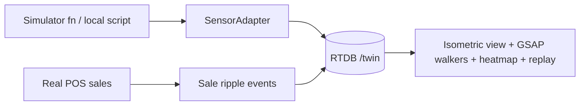

# Flow — Store Twin

Anonymous coordinates only. Replay uses hourly snapshots in Firestore rollups.

## Built (S9 — one polished store)
- **Data:** `scripts/seed/src/twin-sim.ts` (`pnpm twin:sim [storeId…]`, started by `pnpm demo` for PUN-PMC + MUM-PMC) reads floors/zones from the `stores` master and writes `/twin/{store}/{floor}` = `{at, people:{id:{k,x,y,z,a}}}` plus `/twin/{store}/meta` = `{date, entriesToday, billsToday}` at 1 Hz. Sim logic is pure TS in `packages/domain/src/twin.ts` (`stepSim`, hourly pattern 15–60 people, zone-to-zone routes, till queue, floor changes via Entrance/stairs).
- **Seed:** Pune now has 2 floors (F1 Ground, F2 First); the `Billing` zone is renamed `Cash Wrap` for every store.
- **UI:** `/twin` → `components/twin.tsx`. Hand-projected isometric SVG (no PixiJS), GSAP walkers tween between samples, 3D flip floor switcher, store/floor/zone counters, queue + wait at Cash Wrap, dwell heatmap toggle (`accumulateDwell`), ripple at the till when a POS `sales` doc is created (`TwinRepo.subscribeNewSales`), side panel with conversion today and one rule-based suggestion (`staffSuggestion`). Other stores reuse the renderer: run `pnpm twin:sim BLR-FS` etc.
- **Gotchas:** conversion = sim bills ÷ sim entries (meta), not Firestore sales; the ripple is the only real-POS link. Rules: `/twin` is read-only to every non-vendor role; the sim writes with the Admin SDK. Replay scrubber not built.

_Status: S9 built (replay pending). Updated as built._
