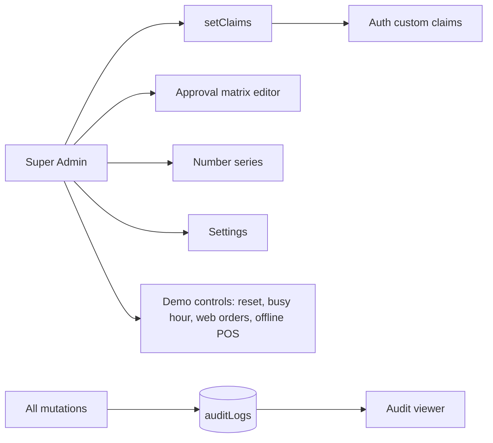

# Flow — Admin & Platform

## Built (S10 — demo polish)
- **Demo controls** (`/admin/demo`, Super Admin only): `demoControl` callable (`functions/src/demo.ts`) → *busy hour* (10 real `completeSaleCore` sales at PUN-PMC T1, opening its shift if needed, and `settings/demo.busyUntil` which `pnpm twin:sim` watches to play the 7 pm peak), *5 web orders* (`simulateWebOrder`), *critical alert* (writes `aiInsights` + each recipient's `inbox`, same shape as `runAlerts`). *Reset* = `POST /api/demo/reset` which re-runs the seed (emulator/dev only). *POS offline* = deep link `POS/sell?offline=1|0` handled in `apps/pos/src/lib/providers.tsx`.
- **Login:** 6 featured roles with mascot avatars (`lib/landing.ts`), the other four under *More roles*. Each role lands on its module dashboard: CFO `/finance`, Buyer `/scm`, Warehouse `/inventory`, Store Manager `/oms`, HR `/hr`, Super Admin `/dashboard`.
- **Walkthrough:** `docs/demo-script.md`. Visual QA spec: `tests/e2e/polish.spec.ts` (screenshots to `tests/e2e/shots/polish`).
- **Seed fixes found on the way:** GSTR-2B doc ids no longer contain `/` from invoice numbers; HR onboarding `doneAt` is an ISO string (serverTimestamp is illegal inside arrays).

_Status: demo controls built; approval-matrix editor and settings screens still planned._
